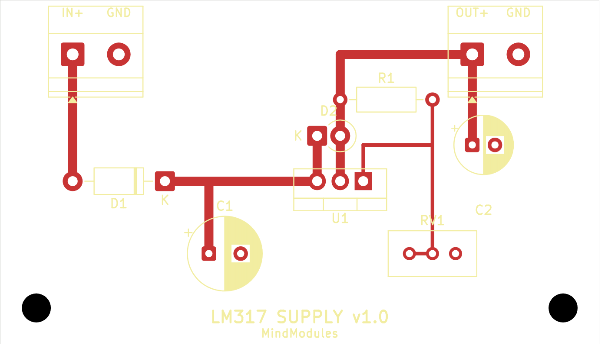

# LM317 Adjustable Bench Supply (1.25 V to about 11.8 V, up to 1 A)

A small through-hole linear regulator board: DC in (15-24 V), adjustable DC out with a trimmer.
It is the classic LM317 circuit done properly: input reverse-polarity diode, output-cap
discharge protection diode, and enough documentation to build, test and order it.



> **Status:** the schematic and PCB pass KiCad ERC (0 issues) and DRC (0 violations, 0 unconnected),
> and the exported netlist matches the intended connections. The board has **not** been fabricated
> or tested on a bench. Treat the first build as a prototype and follow `docs/assembly-and-test.md`,
> starting with a current-limited supply.

## At a glance

| Item | Value |
|---|---|
| Input | 15-24 V DC (needs at least Vout + about 3.2 V: 2.5 V regulator dropout + 0.7 V diode) |
| Output | 1.25 V to about 11.8 V, set by the trimmer |
| Max current | **1 A** (limited by D1, the 1N4007) and needs a heatsink at higher dissipation |
| Board | 66 x 38 mm, 2 layers, through-hole, two M3 holes |
| Tools | KiCad 10 (project files included) |

## Folder map

| Path | Contents |
|---|---|
| `hardware/kicad/` | KiCad project: `.kicad_pro`, `.kicad_sch`, `.kicad_pcb` |
| `hardware/gerbers/` | Gerbers + drill file, ready to upload to a PCB fab |
| `hardware/docs/` | Schematic PDF, PCB PDF and SVG, preview images |
| `hardware/reports/` | DRC, ERC and netlist reports |
| `bom/bom.csv` | Bill of materials |
| `docs/design-notes.md` | Formulas, thermal limits, why each part is there |
| `docs/assembly-and-test.md` | Build order and a test plan with expected readings |
| `docs/ordering-gerbers.md` | How to order the board |
| `tools/` | Python scripts that generated the schematic/PCB (rebuild with KiCad's Python) |

## Quick start

1. Read `docs/design-notes.md` (5 minutes) so you know the limits.
2. Order the PCB using `docs/ordering-gerbers.md`, buy parts from `bom/bom.csv`.
3. Build and test with `docs/assembly-and-test.md`.

## Rebuild the design files

```sh
"<KiCad>/bin/python.exe" tools/build_lm317.py <path-to-this-repo>
sh tools/export.sh <path-to-this-repo> lm317_supply     # needs kicad-cli
```

## License

Personal and educational use for MindModules Inner Circle subscribers. See `LICENSE.md`.
