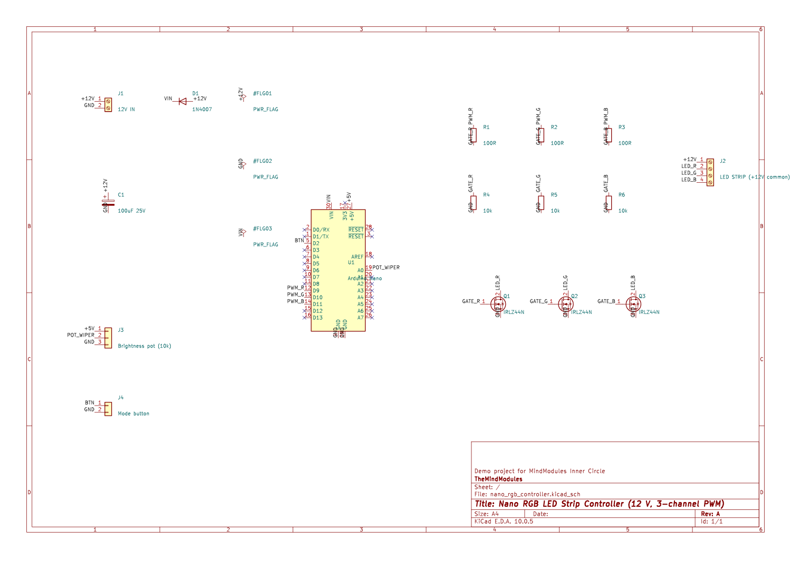

# Nano RGB LED Strip Controller (hobby grade, mixed hardware + code)

Controls a 12 V common-anode RGB LED strip from an Arduino Nano: one pot for brightness, one
button to cycle modes (off, warm white, rainbow, breathing blue). Three logic-level MOSFETs switch the strip.

This one is deliberately **hobby grade**: the documented build is on perfboard (no PCB needed), with a
KiCad schematic you can turn into a PCB later. It is the right project when you want something on the desk by evening.

> **Status:** the schematic passes KiCad ERC with 0 issues and the exported netlist matches the intended connections.
> The firmware logic compiles cleanly (`firmware/test/check_syntax.sh`); its unit tests in
> `firmware/test/logic_check.cpp` were **not executed** here (no host compiler available), so run them yourself.
> The circuit has **not** been built or measured. There is no PCB layout in this package.

## What you get

| Path | Contents |
|---|---|
| `hardware/kicad/` | KiCad project and schematic (`.kicad_sch`) |
| `hardware/docs/` | Schematic as PDF, SVG and PNG |
| `hardware/reports/` | ERC report and netlist |
| `firmware/rgb_lamp/` | Arduino sketch + `lamp_logic.h` (testable logic) |
| `firmware/test/` | Unit tests and syntax-check script |
| `docs/build-perfboard.md` | Step-by-step perfboard build with the full wiring table |
| `docs/design-notes.md` | Current limits, safety, PWM notes, ideas for v2 |
| `docs/test-plan.md` | How to test in the right order |
| `bom/bom.csv` | Bill of materials (from the schematic) |

## Quick start

1. Gather the parts in `bom/bom.csv`.
2. Build it with `docs/build-perfboard.md`.
3. Open `firmware/rgb_lamp/rgb_lamp.ino` in the Arduino IDE (board: Arduino Nano) and upload.
4. Follow `docs/test-plan.md` before connecting the strip to 12 V.

## Behaviour

| Control | Action |
|---|---|
| Pot | Master brightness (squared curve, because eyes see brightness non-linearly) |
| Button | Next mode: warm white, rainbow, breathing blue, off |
| Boot | Starts in warm white |

## License

Personal and educational use for MindModules Inner Circle subscribers. See `LICENSE.md`.
