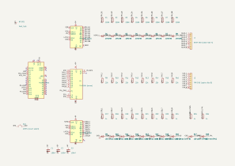

# 8-Wire Cable Continuity Tester (hobby grade, Arduino Nano + shift registers)

Checks a cable with up to 8 wires in about 3 ms and shows the result on LEDs. Plug one end into the
near-end header and the other end into the far-end header. Each wire gets its own LED:
on means good, off means open, blinking means crossed or shorted. A green LED says pass, a red LED says fault,
and a blinking green says the cable is reversed (pin 1 lands on pin 8 and so on, like a rollover cable).

It uses three cheap logic chips: one 74HC595 drives the wires one at a time, one 74HC165 reads all 8 far-end
lines at once, and a second 74HC595 runs the result LEDs. Everything runs from the Nano's USB 5 V.
The documented build is on perfboard. Put an RJ45, USB or JST breakout on each header and you can test those cables too.

> **Status:** the schematic passes KiCad ERC with 0 errors and 0 warnings, and the exported netlist was checked
> against the intended connections. The sketch and the logic header compile with `-Wall -Wextra -Werror`
> (`firmware/test/check_syntax.sh`, using `arm-none-eabi-g++` and small Arduino stubs). The unit tests in
> `firmware/test/logic_check.cpp` were **not executed** here (no host compiler was available), so run them yourself.
> The circuit has **not** been built or measured yet. There is no PCB layout in this package.

## What you get

| Path | Contents |
|---|---|
| `hardware/kicad/` | KiCad project and schematic (`.kicad_sch`) |
| `hardware/docs/` | Schematic as PDF and SVG |
| `hardware/reports/` | ERC report and netlist |
| `firmware/cable_tester/` | Arduino sketch + `tester_logic.h` (all decisions, no hardware calls) |
| `firmware/test/` | Unit tests, Arduino stubs and the syntax check script |
| `docs/build-perfboard.md` | Perfboard layout and the full wiring table |
| `docs/design-notes.md` | How the scan works, the voltage maths, limits and ideas for v2 |
| `docs/test-plan.md` | What to check, in order, after you build it |
| `bom/bom.csv` | Bill of materials (exported from the schematic) |
| `tools/` | Python script that generates the schematic |

## Quick start

1. Gather the parts in `bom/bom.csv`.
2. Build it with `docs/build-perfboard.md`. Use sockets for the three chips.
3. Open `firmware/cable_tester/cable_tester.ino` in the Arduino IDE (board: Arduino Nano) and upload.
4. Follow `docs/test-plan.md`. Start with a few jumper wires before you trust it with a real cable.

## How to read it

| What you see | Meaning |
|---|---|
| Wire LED on | That wire goes to the same pin at the other end and nowhere else |
| Wire LED off | Open: the wire does not arrive anywhere |
| Wire LED blinking | Crossed (arrives at another pin) or shorted (arrives at two or more pins) |
| Green steady | Every wire is good |
| Green blinking | Cable is mirrored end to end (rollover). Wire LEDs stay off in this case |
| Red steady | At least one fault |
| Nothing lit | No cable plugged in |

Press the button to set how many wires your cable has (2 to 8). The wire LEDs show the count for one second.
Pins above that count are ignored, so a 4-wire cable does not show four "open" wires. It starts at 8 after power-up.

The Nano also prints a line per scan on the serial monitor at 115200 baud, for example
`wires=8 FAIL 1:ok 2:ok 3:open 4:short 5:short 6:ok 7:ok 8:ok`.

## Limits

This is a continuity tester, not an ohmmeter. A wire with a few kilohms of bad joint can still read as good.
Do not plug in a cable that is connected to anything powered. See `docs/design-notes.md` for details.

## License

Personal and educational use for MindModules Inner Circle subscribers. See `LICENSE.md`.
