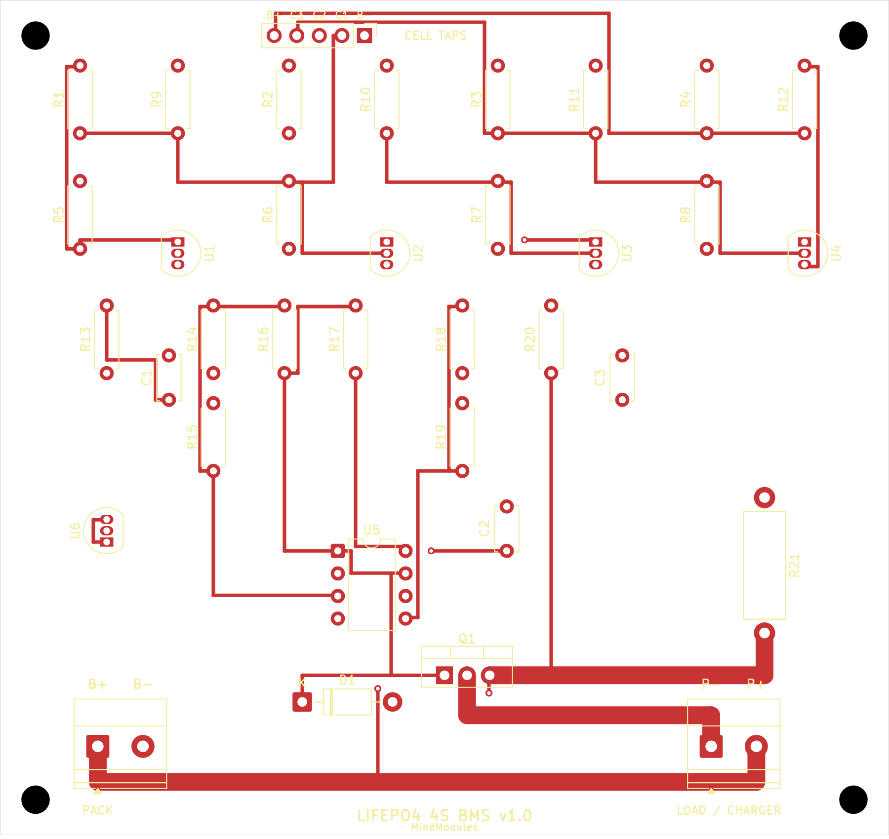

# 4S LiFePO4 BMS: Cell Balancer and Load Protection Board

A through-hole battery management board for a 4 cell LiFePO4 pack (also called LFP or IFP cells,
12.8 V nominal, 14.6 V full). It does two jobs: it balances each cell at the top of charge, and it
disconnects the load on pack under-voltage and on over-current.

**Topic suggested by Sujan Ghosh** on the @themindmodules Instagram channel. Thanks Sujan.



> **Status:** the schematic passes KiCad ERC (0 issues) and the PCB passes DRC (0 violations,
> 0 unconnected), and the exported netlist matches the intended connections. All thresholds were
> calculated by hand and are listed in `docs/design-notes.md`. The circuit was **not simulated**
> and the board has **not been built or tested on a bench**. Treat the first build as a prototype,
> and read `docs/limits-and-safety.md` before connecting a real battery.

## What it does

| Function | How | Value |
|---|---|---|
| Cell balancing | One TL431 shunt per cell, starts bleeding through an 18 ohm resistor | starts at 3.60 V per cell, about 60 to 85 mA |
| Pack under-voltage cutoff | LM393 comparator watches the pack voltage and switches off a logic-level MOSFET | cuts at about 11.04 V (2.76 V per cell), reconnects at about 11.21 V |
| Over-current cutoff | 20 milliohm shunt, second comparator | trips at about 10 A |
| Load switch | IRLZ44N in the negative (low side) line | charging still flows through its body diode |

## What it does not do

It has no over-charge disconnect and no per cell under-voltage cutoff. It needs a proper
CC/CV LiFePO4 charger set to 14.4 V. The full list is in `docs/limits-and-safety.md`.

## At a glance

| Item | Value |
|---|---|
| Cells | 4 in series, LiFePO4 only (not Li-ion, not lead acid) |
| Pack voltage | 10 V to 14.6 V |
| Continuous current | **5 A** (copper width and shunt power), trips at about 10 A |
| Board | 100 x 94 mm, 2 layers, through-hole, four M3 holes |
| Idle drain | roughly 2.6 mA from the whole pack, so do not store a pack on the board |
| Tools | KiCad 10 (project files included) |

## Folder map

| Path | Contents |
|---|---|
| `hardware/kicad/` | KiCad project: `.kicad_pro`, `.kicad_sch`, `.kicad_pcb` |
| `hardware/gerbers/` | Gerbers, drill file and placement file |
| `hardware/docs/` | Schematic PDF, PCB PDF and SVG, preview images |
| `hardware/reports/` | DRC, ERC and netlist reports |
| `bom/bom.csv` | Bill of materials |
| `docs/design-notes.md` | How each block works, every formula and threshold |
| `docs/limits-and-safety.md` | What the board cannot protect against, and LiFePO4 handling rules |
| `docs/assembly-and-test.md` | Build order and a bench test plan using a variable supply |
| `tools/` | Python scripts that generate the schematic and PCB (rebuild with KiCad's Python) |

## Quick start

1. Read `docs/limits-and-safety.md` first.
2. Read `docs/design-notes.md` so you know why the values are what they are.
3. Order the PCB from the files in `hardware/gerbers/` and buy the parts in `bom/bom.csv`.
4. Build and test with `docs/assembly-and-test.md`. Test on a bench supply before any real cells.

## Rebuild the design files

```sh
"<KiCad>/bin/python.exe" tools/build_bms.py <path-to-this-repo>
sh tools/export.sh <path-to-this-repo> lifepo4_4s_bms     # needs kicad-cli
```

`tools/router.py` is a small grid router used to lay the tracks. The power tracks (pack positive,
shunt, load return) are placed by hand at 2 mm width.

## License

Personal and educational use for MindModules Inner Circle subscribers. See `LICENSE.md`.
