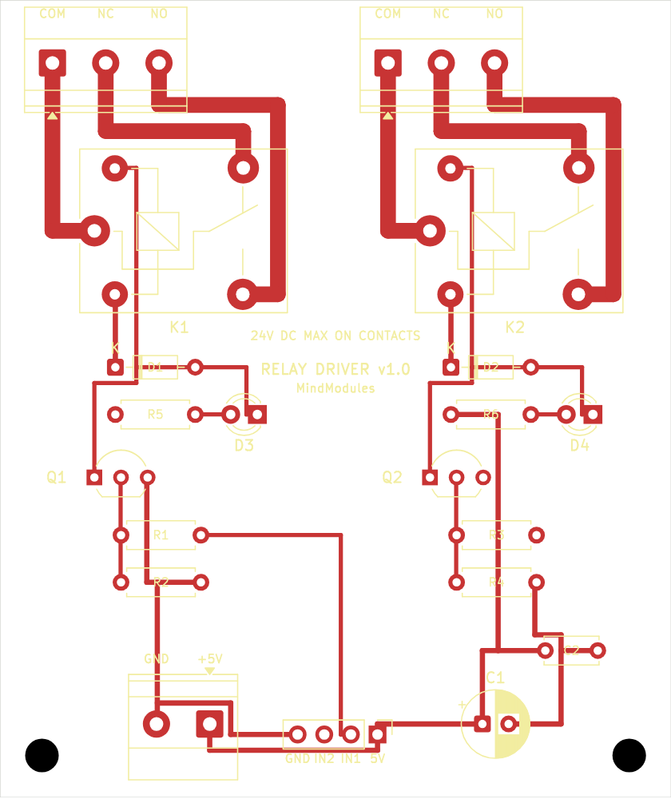

# Two Channel Transistor Relay Driver (5 V coil)

A small through-hole board that lets a microcontroller pin switch a 5 V relay. Each channel uses
an NPN transistor as a low side switch, a base resistor sized for both 5 V and 3.3 V logic,
a pull-down so the relay stays off while the controller boots, a flyback diode across the coil
and an LED that shows when the coil is powered. Two identical channels sit side by side.



> **Status:** the schematic passes KiCad ERC (0 issues) and the PCB passes DRC (0 violations,
> 0 unconnected). The exported netlist was checked against the intended connections, net by net.
> All component values come from hand calculations in `docs/design-notes.md`. The circuit was
> **not simulated** and the board has **not been built or tested on a bench yet**. Treat the first
> build as a prototype and follow `docs/assembly-and-test.md`.

## What it does

| Block | Parts per channel | Value |
|---|---|---|
| Switch | BC337 NPN in TO-92 | coil current about 71 mA, transistor fully saturated |
| Base drive | 470 ohm series resistor | about 8.9 mA from a 5 V pin, about 5.2 mA from a 3.3 V pin |
| Off by default | 10k base pull-down | relay stays off while the input floats |
| Coil protection | 1N4148 across the coil | collector clamps near 5.8 V when the coil turns off |
| Indicator | red LED with 1k | about 3 mA, lights while the coil is on |

## At a glance

| Item | Value |
|---|---|
| Coil supply | 5 V DC, about 150 mA with both relays on |
| Logic input | 3.3 V or 5 V, active high, about 5 to 9 mA per input |
| Relay | SRD-05VDC-SL-C (SPDT, COM, NC and NO brought out) |
| Contact limit on this board | **24 V DC, 3 A**. Low voltage only, never mains |
| Board | 64 x 76 mm, 2 layers, all through-hole, two M3 holes |
| Tools | KiCad 10 (project files included) |

## Connectors

| Connector | Pins |
|---|---|
| J3 screw terminal | +5V, GND (coil supply) |
| J4 pin header | 5V, IN1, IN2, GND (to the microcontroller) |
| J1, J2 screw terminals | COM, NC, NO for relay 1 and relay 2 |

The 5V pin on J4 is the same net as J3. Power the board from one of them, not two different supplies.

## Folder map

| Path | Contents |
|---|---|
| `hardware/kicad/` | KiCad project: `.kicad_pro`, `.kicad_sch`, `.kicad_pcb` |
| `hardware/gerbers/` | Gerbers, drill file and placement file |
| `hardware/docs/` | Schematic PDF, PCB PDF and SVG, top layer preview |
| `hardware/reports/` | DRC, ERC and netlist reports |
| `bom/bom.csv` | Bill of materials |
| `docs/design-notes.md` | How the driver works, every formula and why each value was picked |
| `docs/assembly-and-test.md` | Build order, test plan and a short example sketch |
| `docs/ordering-gerbers.md` | How to order the PCB |
| `tools/` | Python scripts that generate the schematic and PCB (rebuild with KiCad's Python) |

## Quick start

1. Read `docs/design-notes.md` so you know why the values are what they are.
2. Order the PCB from the files in `hardware/gerbers/` (see `docs/ordering-gerbers.md`) and buy the parts in `bom/bom.csv`.
3. Build and check it with `docs/assembly-and-test.md`. Test with a current limited 5 V supply first.

## Rebuild the design files

```sh
"<KiCad>/bin/python.exe" tools/build_relay.py <path-to-this-project>
sh tools/export.sh <path-to-this-project> relay_driver     # needs kicad-cli
```

`tools/router.py` is a small grid router that lays the signal tracks. The relay contact tracks are
placed by hand at 1.5 mm width.

## License

Personal and educational use for MindModules Inner Circle subscribers. See `LICENSE.md`.
